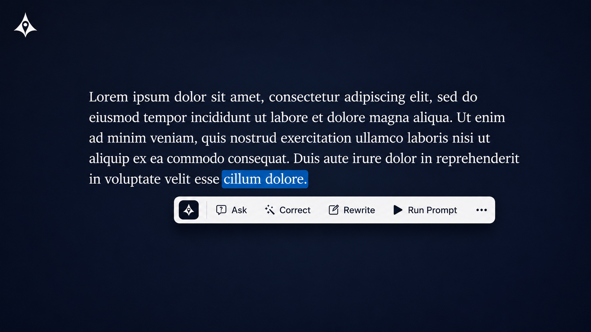
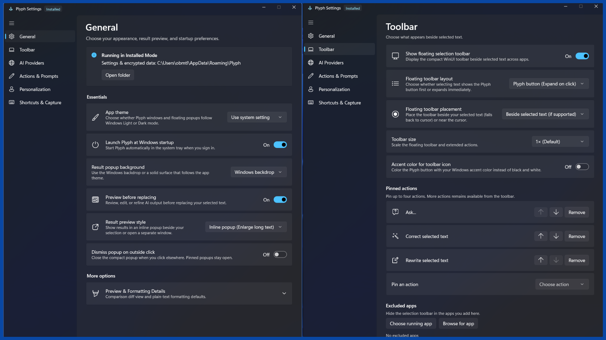
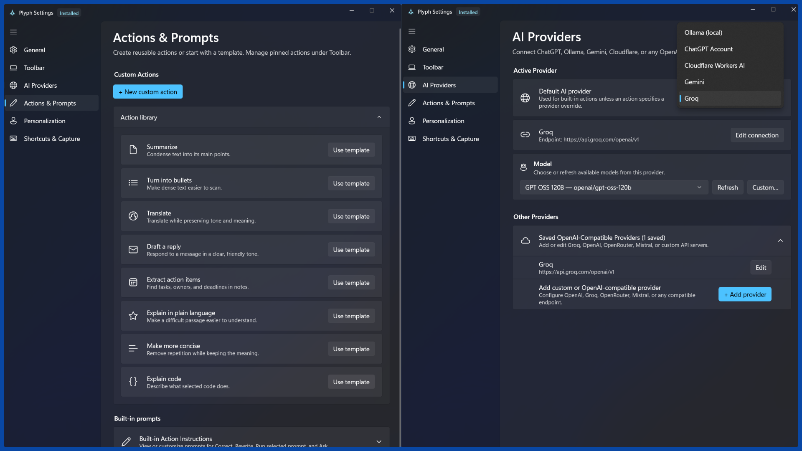

  

<h1 align="center">Plyph for Windows</h1>

  AI assistance for selected text, anywhere in Windows.
   
  Correct writing, rewrite text, translate, summarize, and ask questions.

  
  

  <a href="#preview">Preview</a> ·
  <a href="#features">Features</a> ·
  <a href="#download-and-installation">Download</a> ·
  <a href="#getting-started">Getting started</a> ·
  <a href="#ai-providers">Providers</a> ·
  <a href="#building-from-source">Build</a>

---

## Preview

  

Select text in an application, choose an action from the floating toolbar, then preview, refine, copy, or replace the result.

  

  

## Features

- **Floating toolbar** — Correct, rewrite, translate, summarize, or ask questions about selected text.
- **Preview before replacing** — Review, edit, compare, or copy AI-generated results.
- **Refine and discuss** — Follow up with instructions or questions about a result.
- **Custom actions** — Create prompts or start with a template in the Action library.
- **Keyboard shortcuts** — Run an action or open the actions menu from the keyboard.

## Download and Installation

Download the latest Windows release from the [GitHub Releases](https://github.com/ubaimutl/Plyph-Windows/releases) page.

The downloads are for x64 PCs running Windows 10 or 11.

### Portable

Extract `Plyph-Portable-win-x64.zip` and run `Plyph-Portable.exe`. Keep the `app` folder beside the launcher. Portable settings are stored in a `data` folder beside the launcher.

### Windows Installer

Run `Plyph-Setup.exe` and follow the instructions. Find Plyph in the Start menu. To uninstall it, use **Settings → Apps → Installed apps**.

Plyph runs in the system tray. Open its tray menu for **Settings** or **Exit Plyph**.

## Documentation

- [Getting started](docs/GETTING_STARTED.md) — Install Plyph, choose a provider, and run your first action.
- [Privacy and access](docs/PRIVACY.md) — See what Plyph reads, sends, and stores.
- [Compatibility and limitations](docs/LIMITATIONS.md) — Find out where text selection and replacement can vary.
- [All Windows guides](docs/index.md) — Connect ChatGPT without an API key, customize the toolbar, and create reusable actions.

## Getting Started

1. Open **Settings → AI Providers**, choose a provider, and select a model.
2. Select text in an app such as Notepad. Choose an action from the floating toolbar.
3. Review the generated result, then copy it or choose **Replace**.

Use **Settings → Toolbar** to pin actions or change the toolbar layout. Use **Settings → Actions & Prompts → Action library** to add templates. If the toolbar doesn’t appear in an app, try the **Open actions** shortcut under **Shortcuts & Capture**.

## AI Providers

Plyph can connect to a cloud provider, sign in with a ChatGPT account, or use a model running on your PC.

### Connect to a cloud provider

In **Settings → AI Providers**, choose a connection and select a model:

- **OpenAI-compatible API** — Under **Saved OpenAI-Compatible Providers**, choose **Add provider**. Use a preset or enter the base URL for any OpenAI-compatible endpoint, such as OpenAI, Groq, OpenRouter, or Mistral. Enter an API key if the server requires one, save the connection, and select it as your default provider.
- **Google Gemini** — Select **Gemini** and enter your Gemini API key.
- **Cloudflare Workers AI** — Select **Cloudflare Workers AI** and enter your Cloudflare account ID and an API token with access to Workers AI.
- **ChatGPT Account** — Select **ChatGPT Account** and sign in with your ChatGPT account.

### Run a model locally

- **Ollama** — Start [Ollama](https://docs.ollama.com/windows) and download a model. In **AI Providers**, select **Ollama (local)**, use `http://127.0.0.1:11434`, and choose your model.
- **LM Studio** — Start the [local server in LM Studio](https://lmstudio.ai/docs/developer/core/server). In **AI Providers → Saved OpenAI-Compatible Providers**, choose **Add provider** and the **LM Studio (local)** preset. Use the server address shown in LM Studio, usually `http://127.0.0.1:1234/v1`. Save the provider and select it as your default. You can add other OpenAI-compatible local servers from the same menu.

### Privacy

Plyph sends the selected text and action instructions to the provider configured for that action. When that provider’s model server runs on your PC, the request stays on your PC.

## Building from Source

### Windows

Install the .NET 8 SDK, then run `build-windows.bat` from the repository.

### Linux

On x86_64 Linux with Docker installed, run `bash scripts/build-linux.sh` to cross-compile the Windows app.

Both scripts run the unit tests and write the portable ZIP and installer to `dist/`.

## Contribute

Bug reports and pull requests are welcome. For toolbar or replacement issues, include your Windows version, the app you were using, and steps to reproduce with sample text. Run the tests with `dotnet test tests/Plyph.Core.Tests/Plyph.Core.Tests.csproj`.

## License

Plyph is free and open-source software licensed under the **GNU General Public License v3.0**. See [LICENSE](LICENSE) for the full license text.
